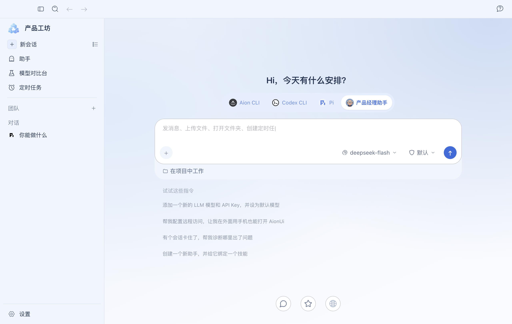
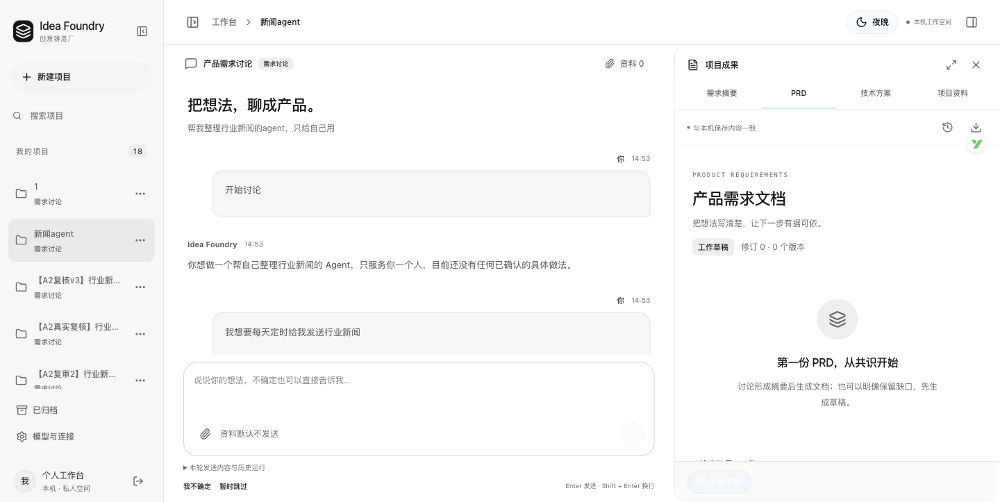

# 产品工坊 · Product Foundry

**把模糊想法整理为可追溯的需求与方案，并探索 AI 协作开发和需求审查。**

产品工坊是我围绕 AI 产品经理工作流程推进的个人项目。重点解决三个问题：产品资料和工具分散、AI 把建议当成用户决定、需求变化后配套文档不同步。

[个人网站项目案例](https://wangyangjuan.surge.sh/projects/product-foundry.html) · [关键产品决策](docs/product-decisions.md) · [验证与限制](docs/validation.md) · [实现来源与证据](docs/provenance.md)

## 项目由三部分组成

| 部分 | 解决什么问题 | 当前阶段 |
| --- | --- | --- |
| 本地桌面工作台 | 集中会话、助手、团队和模型比较；改善模型选择、草稿恢复与异常处理 | 基于已有开源与定制版本继续优化，完成本机 Electron 和部分 CLI 验证；完整新安装包尚未发布 |
| 配套需求规划原型 | 从想法和资料出发，讨论需求、记录决定，生成关联版本的 PRD 与技术方案 | 独立本机网页原型，完成前后端接入与多轮验收；最新修复后的真实模型全流程与最终体验验收仍待补齐 |
| 独立需求审查 Agent POC | 依据已确认需求、排除项和证据，审查遗漏、冲突及未经确认的扩展 | 使用 Pi、真实模型与 MCP 完成限定测试资料上的四类案例验证；尚未接入前两部分的统一界面 |

三部分共享产品方向，运行入口和数据仍分别维护。当前交付是本地原型与 POC，不宣称已经整合上线。

## 我的工作

我负责产品范围、流程与交互规则，借助 Codex、Pi 等 AI 编码工具推进实现、检查结果和修复。已有框架、基础组件与历史定制的归属见[来源说明](docs/provenance.md)。

- **需求澄清**：区分已确认需求、AI 建议、未知项、假设与排除项，保留用户原话；接受建议绑定实际展示的内容。
- **文档一致性**：区分编辑草稿、保存版与确认版；技术方案关联明确的 PRD 确认版本；需求变化提示旧方案待更新；AI 修改先展示差异。
- **协作与恢复**：推进团队模型配置、模型比较草稿恢复、离开提醒和分类错误提示，把失败及重试规则写成可验收行为。
- **审查边界**：设计证据不足时待确认、暂时失败重试、调用预算与提交前校验；审查建议独立保存，应用到原文需要用户另行确认。

## 一个具体流程

用户提交“帮我整理行业新闻的 Agent”想法，经过讨论确定用户、范围和排除项；系统先生成 PRD 草稿，用户补全并确认一个版本，再生成与该版本对应的技术方案。后续修改需求时，旧方案显示待更新；AI 修改先预览，由用户决定是否接受。

该流程属于需求规划原型。桌面模型比较和独立审查 POC 分别验证自己的任务，不把它们写成已经串联完成的一条自动流程。

*原型的历史界面名称为 Idea Foundry／初造。图中为本机示例界面。*

## 已验证与下一步

已有记录覆盖桌面真实模型比较、团队模型配置、两种 CLI 的简单工具执行；需求规划原型的版本与确认规则、资料操作及页面接入；审查 POC 的冲突、失败恢复、缺少证据和预算停止案例。各批次的环境与限制见[验证说明](docs/validation.md)。

下一步是补齐最新需求规划版本的真实模型全流程与体验验收，再确定三部分的接入方式。后续使用数据应观察人工补全次数、错误确认、版本不匹配和失败恢复；目前没有用户规模、效率提升或留存的业务结论。

本仓库整理公开产品案例与截图。整理日期：2026-10-11。
