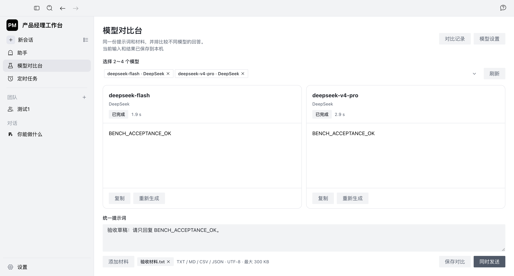

# 验证结果与限制

本页整理已有验证记录，未在 2026-10-11 重新运行产品或付费模型。各批次使用不同代码版本、环境和检查范围，测试数量不相加，也不作为个人原创规模或业务成效。证据标题与日期见[来源索引](provenance.md#证据索引)。

## 本地桌面工作台

| 批次 | 已有结果 | 验证范围 |
| --- | --- | --- |
| 团队创建修复 · 2026-09-29 · E06 | 60 项针对性测试通过，类型与国际化检查通过；真实模型完成内置助手团队的委派和回复 | 默认模型解析、无可用模型阻止创建、重复初始化保护及重试；该批次未实测外部 CLI 完整协作 |
| 桌面与 CLI 验收 · 2026-09-29 · E07 | 实际 Electron 操作与截图检查；全项目 5,067 项通过、5 项跳过 | 全项目统计包含已有框架与历史测试，不代表本轮新增；实际检查模型比较、草稿恢复和团队成员模型保存 |

桌面批次中，两种已配置模型实际返回文本，刷新后结果保留。取消离开、确认离开停止和部分输出保留使用可控流式响应验证；认证失败使用模拟响应验证，不能归为真实供应商故障。

Codex 与 Pi 分别在本机通过显式模型配置完成读取测试输入、写出预期结果的简单工具任务。这不证明所有模型、权限模式或复杂多成员协作均已通过。完整新安装包尚未发布。[依据：E07、E08]

*更名前的功能验收界面：两款模型使用同一测试输入返回固定验收文本，证明调用与并排呈现链路走通，不作为回答质量排名。*

## 配套需求规划原型

| 批次 | 已有结果 | 验证范围与限制 |
| --- | --- | --- |
| A3 独立修复复验 · 2026-09-27 · E03 | 236 项全量回归、16 项独立反例通过 | 离线检查；可作为联调基线，不等于最终用户验收 |
| F1 真实模型虚构案例 · 2026-09-27 · E04 | 实际 3 个模型任务；讨论、PRD 与技术方案生成成功；人工补全后确认 PRD v2，方案关联 v2，配套导出匹配 | 使用虚构新闻摘要 Agent 需求；原始 v1 确认被阻止，链路有条件走通，发现直接否定表达漏识别 |
| F1-R1 修复复验 · 2026-09-27 · E05 | 新增 32 项反例回归；268 项后端测试、16 项 A3 独立用例通过 | 否定表达缺陷的离线修复验证；未重新调用真实模型全流程 |
| 新版工作台接入 · 2026-09-29 · E10 | 22 项前端测试、类型检查与生产构建通过；资料与项目操作通过实际页面检查 | 1440、1024、768、390 宽度无横向溢出；明暗切换可用；本轮未新增真实模型全链路验收 |

已复现问题的例子：用户说“不自动发送”时曾没有形成排除决定；修复补齐具名能力的直接否定识别，并保留疑问、条件和双重否定等反例保护。旧运行记录没有被重写成修复后的结果。

当前仍需补齐最新代码的真实模型全流程与产品负责人最终体验验收。自动对齐属于规则判断，复杂混合句仍需人工检查；需求编号的稳定性依赖模型 key／标题，结构和配套检查通过也不代表每段方案文字已经人工认可。

## 独立需求审查 Agent POC

最终案例记录的执行日期为 **2026-10-05**。四类案例使用真实模型、实际 MCP 连接及工具发现，输入为限定的测试资料，原 PRD 保持不变。[依据：E09]

| 案例 | 已有验证结果 | 工具调用／模型轮数 |
| --- | --- | --- |
| 冲突审查 `conflict-v3` | 找到必需需求遗漏、排除项回流和版本冲突；候选稿校验后独立保存为 `ready` | 7／6 |
| 暂时失败 `recover-once-v3` | 观察到读取失败，重试同一文档成功，再完成审查；原稿与人工确认要求保留 | 11／6 |
| 缺少证据 `missing-evidence-v3` | 保存为 `needs_information`，未将无法证明的内容确认；问题分类标签仍有不一致警告 | 7／6 |
| 调用上限 `call-limit` | 达到两次工具调用上限后停止，没有提交建议或超出预算 | 2／2 |

另外记录了 7 项 MCP stdio 集成检查通过，覆盖工具发现、限定文件权限、证据检索、不合格提交拦截、独立保存与失败处理。这些是限定案例的机制验证，不是泛化准确率、生产 SLA 或企业上线结论。

`ready` 只表示建议准备好；是否应用到原文仍由用户另行确认。POC 尚未嵌入桌面工作台或需求规划原型的统一界面。

## 接下来观察什么

在真实使用中，计划观察有效项目配套导出完成率、人工补全次数、误确认与排除项回流、版本不匹配、失败恢复、耗时和模型用量。指标口径与基线尚待建立；目前不宣称效率提升、采纳率、留存或用户增长。
